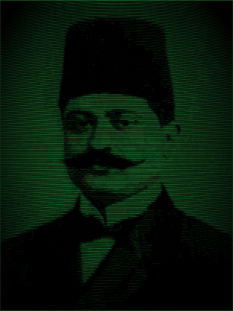

  

  

  C# &nbsp;·&nbsp; .NET &nbsp;·&nbsp; Windows &nbsp;·&nbsp; VS  
  takma ad yeter. cv yok, uzun bio yok. 
  kucuk tool yazarim. oyun kiyisinda is yaparim. 
  ayni isi 2 kere tikliyorsam C# ile kestiriyorum. 
  linux rozeti asmam. yalan olmasin.

  tikla -&gt; yaz &nbsp;&nbsp; ayni tusa 12 kere basma 
  kurulum -&gt; exe &nbsp;&nbsp; 12 adimlik readme istemem 
  ayar -&gt; arac &nbsp;&nbsp; neredeydi o menu 
  rutin -&gt; kod &nbsp;&nbsp; elle yapmam, sinir bozar

  kisa yol. harita yok. gerisini oyna.

